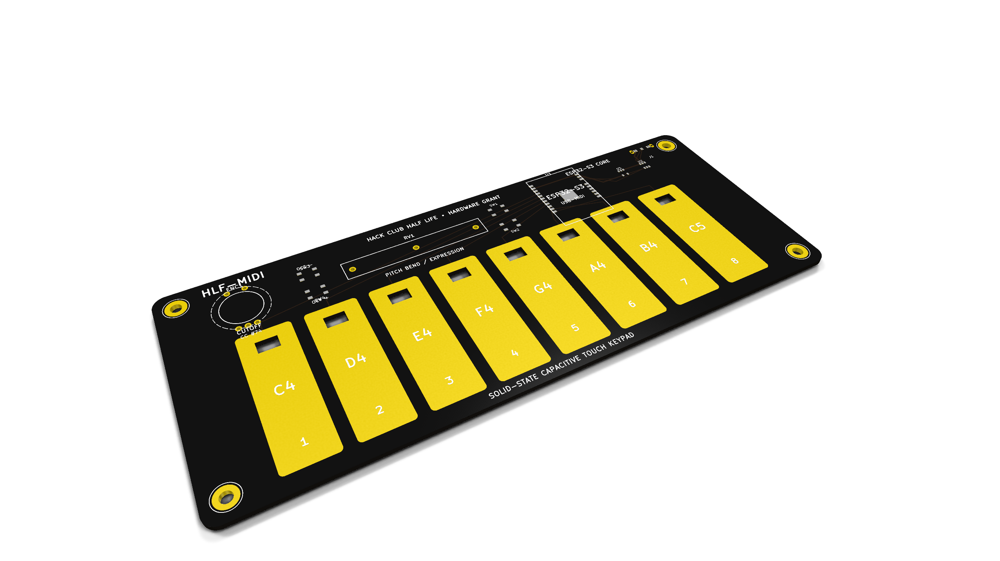
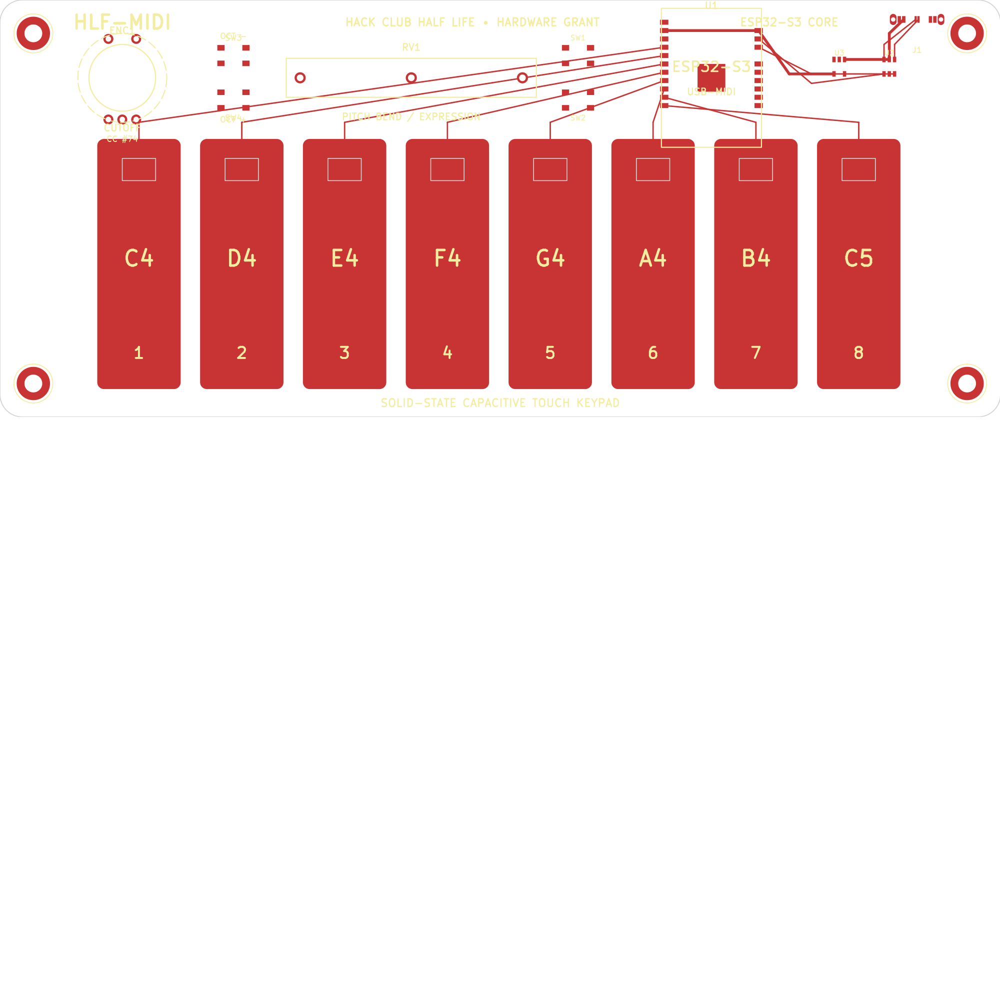
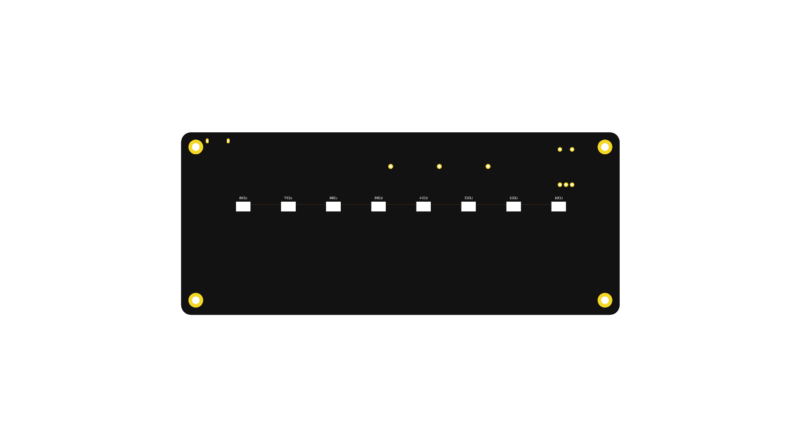

# HLF-MIDI

A super slim, solid-state MIDI keyboard built with an ESP32-S3 that uses gold capacitive touch pads instead of mechanical switches. It plugs straight into any laptop, phone, or DAW as a class-compliant USB-MIDI device.



---

## What It Does

- **8 Capacitive Touch Keys**: Plays an 8-note major scale (C4 to C5) with zero mechanical moving parts.
- **Expressive Pitch & Filter Controls**: Features a 45mm Bourns slide potentiometer for smooth pitch bend / modulation, plus an EC11 rotary encoder for filter cutoff (MIDI CC #74).
- **Integrated Sustain**: Click down on the rotary encoder knob to toggle MIDI sustain on/off.
- **Octave Shifting**: Dedicated tactile pushbuttons let you shift up and down across the entire MIDI range (C2 through C8).
- **RGB Reactive Backlighting**: 8 reverse-mount SK6812 NeoPixel LEDs shine up through cutouts in the PCB, giving dynamic visual feedback when keys are struck and color-coding the active octave.
- **Plug-and-Play USB-MIDI**: Connects over native Full-Speed USB-C without requiring drivers. Works instantly in Ableton Live, FL Studio, Logic Pro, GarageBand, Reaper, and browser Web MIDI synths.

---

## Why I Made It

Most compact MIDI controllers you can buy (like the Akai MPK Mini or Novation Launchkey) are pretty bulky, use cheap plastic key mechanisms that wear out over time, and end up being 25mm to 35mm thick. When traveling or hacking on music projects, I wanted something completely flat that I could literally slide into a laptop sleeve alongside my notebook.

I realized that with modern microcontrollers like the ESP32-S3, you don't even need physical switch mechanisms. The PCB itself can be the instrument. By etching exposed capacitive touch pads with an ENIG gold finish directly on the top copper layer, the keyboard has:
1. An ultra-thin profile of just a few millimeters.
2. Zero mechanical parts to wear down or break.
3. Sub-millisecond touch response with native hardware relaxation oscillators.
4. An awesome cyberpunk look where you're touching the raw circuit board.

---

## How It Works

```
[Finger Touch] -> [ENIG Gold Pad] -> [ESP32-S3 Touch Peripheral (1-8)]
                                              |
[Slide Potentiometer] -> [12-bit ADC] --------+---> [TinyUSB MIDI Stack] -> [USB-C to DAW]
[Rotary Encoder] ------> [GPIO Interrupts] ---+
                                              |
                                              v
                              [SK6812 Reverse NeoPixel LEDs]
```

1. **Capacitive Touch Sensing**: Each key is a 15mm × 45mm copper pad on the top layer (`F.Cu`), cleared of solder mask and plated in ENIG gold. When your finger touches or approaches the pad, it adds human body capacitance, shifting the frequency of the ESP32-S3 internal RC relaxation oscillator.
2. **Noise Rejection & Calibration**: On boot, the firmware takes 64 samples across all 8 channels to set an adaptive baseline. A calibrated hysteresis threshold (`TOUCH_HYSTERESIS_DROP`) ensures instant note triggers without false positives.
3. **Low-Jitter Analog Filtering**: The Bourns slide potentiometer is sampled via the ESP32-S3 12-bit ADC. An 8-point Exponential Moving Average (EMA) filter eliminates ADC thermal noise and wiper jitter before converting readings into 14-bit high-resolution MIDI Pitch Bend messages.
4. **Native USB-MIDI Engine**: The ESP32-S3 has dedicated USB OTG hardware. Using the TinyUSB stack, the controller identifies itself to the host OS as a class-compliant MIDI device, streaming standard Note On, Note Off, Pitch Bend, and Control Change (CC) packets at 500Hz with sub-millisecond latency.
5. **Reverse Optical Backlighting**: Reverse-mount SK6812 NeoPixels are soldered to the bottom copper layer (`B.Cu`), shining up through 6mm × 4mm slots cut into the PCB (`Edge.Cuts`). The translucent FR4 substrate acts as an optical diffuser, creating a clean under-glow beneath your fingertips.

---

## Screenshots & Hardware Design

### 1. KiCad 2D PCB Layout
The board is an ultra-compact 180mm × 75mm 2-layer PCB designed in KiCad 9/10:



### 2. Complete Electrical Schematic
Features the ESP32-S3-WROOM-1, TLV75533 3.3V LDO regulator, USBLC6-2SC6 ESD protection, slide pot, encoder, and reverse NeoPixel chain:


### 3. 3D Board Views (Top & Perspective)
Rendered natively using KiCad's raytracing engine with floor shadows and realistic board stackup colors:




---

## Hardware Files

All design files are located in the [`kicad/`](kicad/) directory:
- **KiCad Project**: [`kicad/hlf_midi.kicad_pro`](kicad/hlf_midi.kicad_pro)
- **Schematic**: [`kicad/hlf_midi.kicad_sch`](kicad/hlf_midi.kicad_sch) (printable PDF: [`kicad/hlf_midi_schematic.pdf`](kicad/hlf_midi_schematic.pdf))
- **PCB Layout**: [`kicad/hlf_midi.kicad_pcb`](kicad/hlf_midi.kicad_pcb)
- **Bill of Materials**: [`kicad/bom.csv`](kicad/bom.csv) (with exact LCSC part numbers)
- **SMT Centroid / CPL**: [`kicad/cpl.csv`](kicad/cpl.csv)
- **Fabrication Gerbers**: [`kicad/hlf_midi_gerbers.zip`](kicad/hlf_midi_gerbers.zip) (JLCPCB / PCBWay ready)

---

## Firmware

The firmware is written in Arduino C++ for the ESP32-S3. It handles:
- Real-time capacitive touch baseline calibration.
- Rotary encoder quadrature decoding with acceleration.
- Slide fader EMA filtering and 14-bit pitch bend mapping.
- Octave switching with responsive LED color updates.
- Fast, non-blocking USB-MIDI message dispatch.

Source code: [`firmware/hlf_midi_firmware/hlf_midi_firmware.ino`](firmware/hlf_midi_firmware/hlf_midi_firmware.ino)

---

## Getting Started

1. Open [`kicad/hlf_midi.kicad_pro`](kicad/hlf_midi.kicad_pro) in KiCad to explore the schematic and PCB routing.
2. In Arduino IDE, open [`firmware/hlf_midi_firmware/hlf_midi_firmware.ino`](firmware/hlf_midi_firmware/hlf_midi_firmware.ino).
3. Under **Tools**, configure:
   - **Board**: `ESP32S3 Dev Module`
   - **USB CDC On Boot**: `Enabled`
   - **USB Mode**: `Hardware CDC and JTAG`
4. Connect the board via USB-C and hit **Upload**.
5. Open your DAW (Ableton, FL Studio, Logic, etc.), select **HLF-MIDI** in your MIDI input devices, and start playing!

---

## Author

Designed and built by **Harinandan J V** for Hack Club's Half Life hardware program.

## Open Source

This project is open source under the MIT License. Feel free to modify, build, or adapt it for your own custom instruments!
