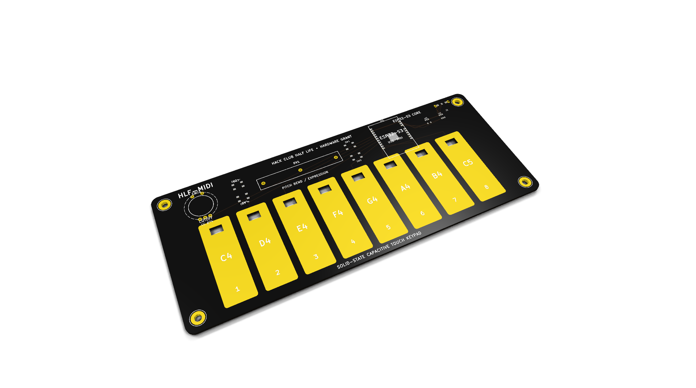
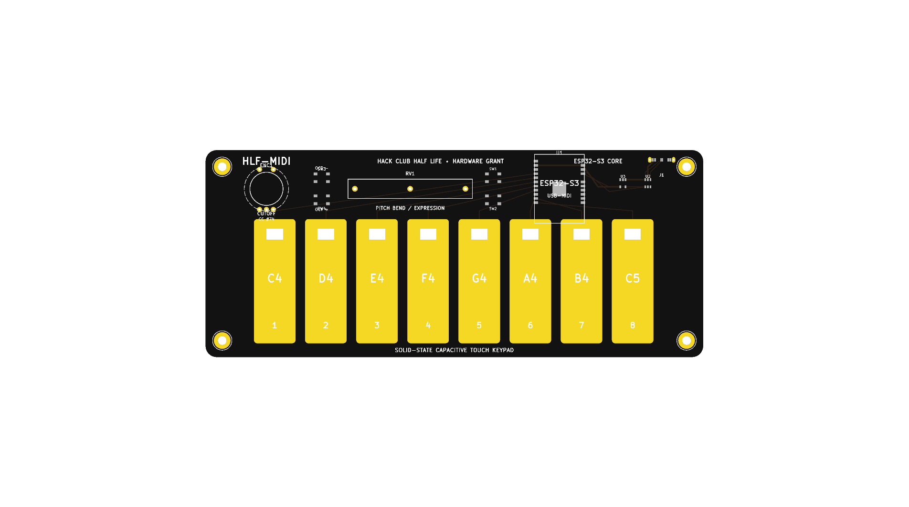
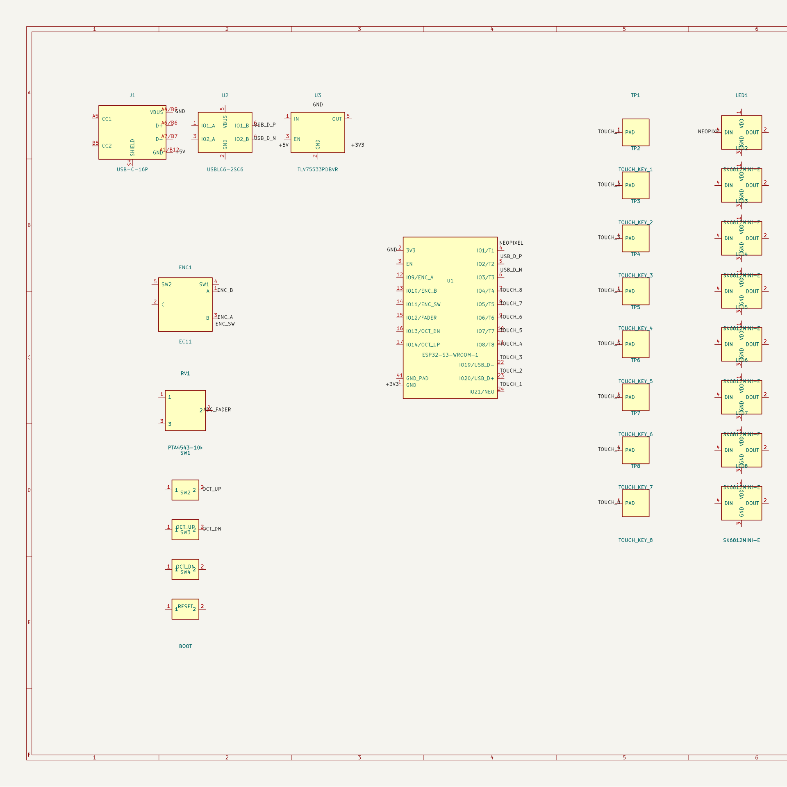

# HLF-MIDI

A super slim, solid-state MIDI keyboard built with an ESP32-S3 that uses capacitive touch pads instead of mechanical switches. It plugs straight into any laptop, phone, or DAW as a plug-and-play USB-MIDI device.

---

## What is this?

Traditional MIDI keyboards are usually pretty bulky, full of plastic mechanisms, and annoying to carry around. For Hack Club's Half Life, I wanted to build something super flat and minimal: a solid-state MIDI keyboard with zero moving key parts, where the keys are literally etched onto the PCB in gold (ENIG).

Your fingers touch the pads directly, the ESP32-S3 detects the electric field change with its built-in hardware capacitive touch channels, and it immediately sends standard MIDI notes to your computer or synthesizer over native USB-C.

---

## How it works

1. **Capacitive Touch Keys**: Instead of mechanical switches, the 8 piano keys (C4 to C5) are exposed copper pads with an ENIG gold finish. When your finger gets close or touches a pad, it shifts the capacitance.
2. **ESP32-S3 Detection**: The ESP32-S3 reads all 8 touch channels in real time with hardware relaxation oscillators at sub-millisecond speeds.
3. **USB-MIDI Protocol**: When a key is tapped, the microcontroller sends standard MIDI Note On and Note Off packets over native Full-Speed USB. No drivers or extra software needed—it works automatically with Ableton, FL Studio, Logic, GarageBand, or web synths.
4. **Slide Fader & Rotary Knob**: A 45mm Bourns slide potentiometer lets you control pitch bend or modulation smoothly, while an EC11 rotary encoder handles filter cutoff or CC controls. You can also click the knob to toggle sustain.
5. **Octave Switching**: Dedicated tactile buttons let you shift up or down across octaves on the fly.
6. **Reverse-Mount NeoPixels**: 8 addressable RGB LEDs are mounted on the back of the board shining up through cutouts in the PCB, giving each key a clean ambient glow that reacts whenever you hit a note.

---

## Schematic & Hardware Design

The whole board was designed in KiCad with a clean 2-layer stackup:
- **MCU**: ESP32-S3-WROOM-1 (Xtensa dual-core @ 240MHz, native USB OTG, 14 capacitive touch channels)
- **Power**: 5V from USB-C stepped down to 3.3V through a low-noise TLV75533 LDO regulator
- **Protection**: USBLC6-2SC6 ultra-low capacitance TVS diode array protecting USB lines against ESD shocks
- **Board Dimensions**: 180mm × 75mm slim profile with 4mm corner radii and M3 mounting holes
- **Backlighting**: SK6812 MINI-E reverse-mount NeoPixels

All hardware design files are in the [`kicad/`](kicad/) directory:
- Schematic: [`kicad/hlf_midi.kicad_sch`](kicad/hlf_midi.kicad_sch) (and printable [`kicad/hlf_midi_schematic.pdf`](kicad/hlf_midi_schematic.pdf))
- PCB Layout: [`kicad/hlf_midi.kicad_pcb`](kicad/hlf_midi.kicad_pcb)
- Full Project: [`kicad/hlf_midi.kicad_pro`](kicad/hlf_midi.kicad_pro)
- Bill of Materials: [`kicad/bom.csv`](kicad/bom.csv)
- JLCPCB SMT Centroid: [`kicad/cpl.csv`](kicad/cpl.csv)
- Production Gerbers: [`kicad/hlf_midi_gerbers.zip`](kicad/hlf_midi_gerbers.zip)

---

## Firmware

The firmware is written in Arduino C++ for the ESP32-S3 using the native TinyUSB stack. It handles touch baseline calibration, exponential moving average (EMA) filtering for the analog slider to prevent jitter, and sends class-compliant MIDI packets at ~500Hz.

The code is available in [`firmware/hlf_midi_firmware/hlf_midi_firmware.ino`](firmware/hlf_midi_firmware/hlf_midi_firmware.ino).

---

## Getting Started

1. Open [`kicad/hlf_midi.kicad_pro`](kicad/hlf_midi.kicad_pro) in KiCad to view the full schematic and 3D PCB layout.
2. To flash the firmware, open [`firmware/hlf_midi_firmware/hlf_midi_firmware.ino`](firmware/hlf_midi_firmware/hlf_midi_firmware.ino) in Arduino IDE.
3. Select **ESP32S3 Dev Module**, enable **USB CDC On Boot** and **USB Mode: Hardware CDC and JTAG / TinyUSB**, and hit Upload.
4. Plug it into your computer via USB-C, launch your favorite DAW, and start playing!

---

## Author

Designed and built by **Harinandan J V** for Hack Club's Half Life hardware program.

## Open Source

This project is completely open source under the MIT License. Feel free to use, modify, or build upon it for your own synths and music gear!
